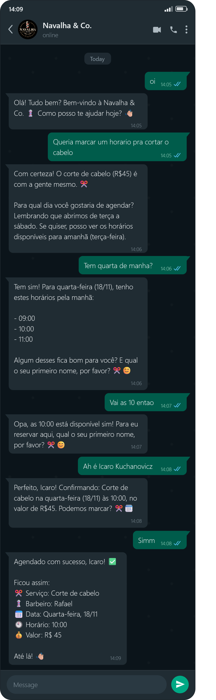
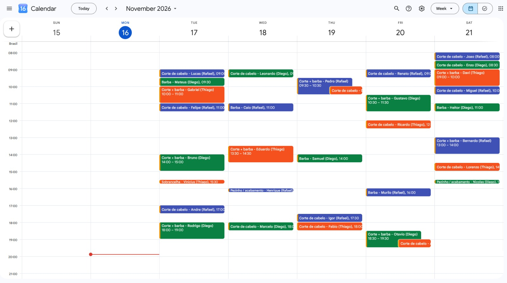
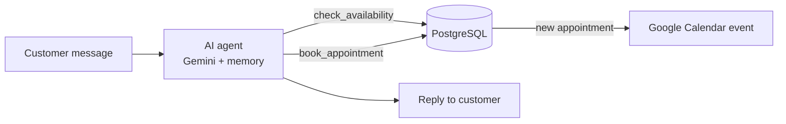

# AI Barbershop Receptionist

An AI receptionist that books haircuts over chat, 24/7, and puts every appointment straight into the barbershop's Google Calendar.

Built with **n8n**, **Google Gemini**, **PostgreSQL** and **Google Calendar**, self-hosted on a home server.

## Demo

### 1. The customer books in the chat

<p align="center">
  
</p>

<p align="center"><sub>A real conversation with the bot, in Brazilian Portuguese, shown in a WhatsApp layout.</sub></p>

In a few messages the receptionist greets the customer, gives the price, checks which times are actually free on Wednesday morning, asks for the name, confirms the details and books.

### 2. The barber sees it in Google Calendar



Every booking becomes a calendar event with the service, customer, barber and price. Each barber has a color: **Rafael** blue, **Diego** green, **Thiago** orange.

## The problem

Small barbershops take bookings through WhatsApp, but the barbers are busy cutting hair. Messages wait for hours, customers book somewhere else, and the schedule lives in someone's head or a paper notebook.

## What it does

- Answers customers in their own language (Brazilian Portuguese by default), in short, friendly messages
- Knows the services, prices, barbers and opening hours
- Checks real availability before offering times, and never invents a slot
- Confirms the details with the customer, then books
- Sends every booking to the barbershop's Google Calendar, one color per barber

## How it works



A single n8n workflow with two parts:

1. **Conversation:** Telegram Trigger, AI Agent (Gemini, chat memory, two database tools), reply.
2. **Calendar sync:** a Postgres Trigger fires on every new appointment, looks up the details and creates the Google Calendar event.

## Design decisions

- **The database enforces the rules, not the AI.** Availability, opening hours, past times and double-booking are all checked in PostgreSQL. A gist exclusion constraint makes it impossible for one barber to have two overlapping appointments, even if two customers book the same slot at the same second.
- **The AI can't make up times.** The agent has to call `check_availability` before offering anything. `book_appointment` returns `ok: false` with a reason when a slot is no longer valid, so the agent can offer alternatives.
- **Small, fixed tools.** The agent only fills in parameters (date, service, barber, time). It never writes SQL.
- **The calendar is a view, the database is the source of truth.** The barber gets a familiar calendar on their phone, and the booking logic stays in one place.

## About the channel

The bot runs on **Telegram** in this demo, and the chat above is the same conversation shown in a WhatsApp layout.

Meta's official WhatsApp API requires a verified business before any message can be sent, even from a test number. For a real client, the barbershop verifies its own business with Meta and the bot runs on their WhatsApp number. Only the input and output nodes change; the agent, the tools and the calendar sync stay the same.

## Stack

| Part | Tool |
|---|---|
| Automation | n8n (self-hosted, Docker) |
| AI model | Google Gemini |
| Data | PostgreSQL |
| Calendar | Google Calendar API |
| Chat channel | Telegram Bot API |
| Hosting | Home server, exposed through Cloudflare Tunnel |

## Run it yourself

1. Create the database with [`database/schema.sql`](database/schema.sql). The setup steps are at the top of the file, and it includes sample barbers, services and opening hours.
2. In n8n, import [`workflow.json`](workflow.json).
3. Create and select the credentials: Telegram (bot token from @BotFather), Google Gemini, Postgres (the `barbershop` database) and Google Calendar OAuth2.
4. In the **Add to Google Calendar** node, choose the calendar the barbershop will use.
5. Publish the workflow and send your bot a message.

## Repository

```
workflow.json        n8n workflow, credentials removed
database/schema.sql  tables, sample data and the booking functions
docs/                screenshots
```
